  

  把控制理论写进固件，让机器真正跑起来

  
  
  

## 🧭 关于我

- 🔧 **嵌入式底层**：STM32H7（H723 / DM-MC02-H7）平台开发，CAN-FD、RS485、DMA 与 Cache 一致性、USB 设备
- 🤖 **机器人运控**：四足步态与运动控制，持续跟进 HIM / H∞ 一类基于学习的运控方法
- 🏁 **RoboCon**：赛题与场地建模（XML），舵轮 / 麦轮底盘控制例程
- 📚 **乐于沉淀**：把调试时踩过的坑写成能复现的文档，顺手整理运控学习资料
- 🎯 **当前重心**：完善 DM02 开源代码里的电机驱动与底盘例程，让新队伍少走弯路

> 我相信好的开源不只是"能跑"，而是"别人照着文档也能跑起来"。

## 🛠 技术栈

  
  
  
  
  
  
  
  
  

## 📦 精选项目

| 项目 | 简介 | 技术 |
| :--- | :--- | :--- |
| **[DM02_control](https://github.com/heartpain-kong/DM02_control)**    | 达妙 DM-MC02-H7 开发板开源代码：宇树 / 灵足 / 达妙 / DJI 电机驱动库、大疆遥控器例程、舵轮与麦轮底盘控制，附 RS485 时隙、Cache 与 DMA、CAN-FD 分频等实战说明 | `C` `STM32H7` |
| **[LGRobotSystem](https://github.com/heartpain-kong/LGRobotSystem)**    | 基于 STM32H723 的机器人控制系统固件：CubeMX + CMake 工程、USB 设备栈，含 DAPLink / ST-Link 烧录配置 | `C` `STM32H723` `USB` |
| **[rc2027_field](https://github.com/heartpain-kong/rc2027_field)**    | RoboCon 2027 场地 XML 文件，供仿真与场地建模直接复用 | `Python` `XML` |
| **[LocoWiki](https://github.com/heartpain-kong/LocoWiki)**    | 机器人运控学习指南：赛题拆解、知识库、论文学习资源，在线版见 [locowiki.github.io](https://locowiki.github.io/) | `Docs` |

## 📊 GitHub 数据

  

  

## 📚 学习与分享

- **[LocoWiki](https://locowiki.github.io/)** — 四足运控入门路线：从基础理论到论文复现的索引
- **[HIMLoco](https://github.com/heartpain-kong/HIMLoco)** — Hybrid Internal Model 与 H∞ 运控的官方实现（跟进中）
- **[damiao_mc02_bsp](https://github.com/heartpain-kong/damiao_mc02_bsp)** — 达妙 DM-MC02-H7 底层库参考

## 📫 联系我

  
  

欢迎交流机器人、运控与嵌入式方面的任何问题；提 Issue 或直接开 PR 都很快回复。

---

  <b>In brief</b> — I build legged-robot motion control and embedded firmware (STM32H7, CAN-FD, motor drivers), and write down what I learn along the way.

  如果这些仓库帮到了你，一个 ⭐ 就是最好的鼓励 · Built with ❤️ and a lot of oscilloscope traces

