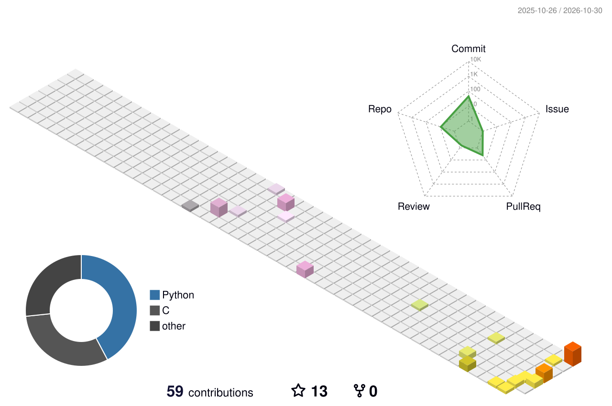

<p align="center">
  
</p>

<p align="center">
  <a href="https://github.com/heartpain-kong">
    
  </a>
</p>

<p align="center">
  
  
  
</p>

## 🍮 About Me

```yaml
👋 name      : 空情心白  (heartpain-kong)
🤖 role      : 机器人 / 嵌入式开发者
🎯 focus     : [ 四足运控, 电机驱动, 底盘控制 ]
🛠️ working   : DM02 开发板开源 · LGRobotSystem
🧠 learning  : 强化学习运控 · Sim2Real
💬 ask me    : STM32H7 / CAN-FD / RS485 / RoboCon 场地
📫 reach     : github.com/heartpain-kong
```

<br/>

<table align="center" width="100%">
<tr>
<td valign="top" width="33%">

### 🦾 在做什么

- 🦿 **四足运控**<br/>&nbsp;&nbsp;步态设计与运动控制
- 🔧 **电机驱动**<br/>&nbsp;&nbsp;宇树 / 灵足 / 达妙 / DJI
- 🧩 **底盘控制**<br/>&nbsp;&nbsp;舵轮与麦轮例程
- 🏁 **RoboCon**<br/>&nbsp;&nbsp;赛题拆解 + 场地建模

</td>
<td valign="top" width="34%">

### 🛠️ 技术栈

<p>
  
  
  
  
  
  
  
</p>

</td>
<td valign="top" width="33%">

### 🌐 找到我

- 🐙 [github.com/heartpain-kong](https://github.com/heartpain-kong)
- 📚 [locowiki.github.io](https://locowiki.github.io/)
- 💬 [DM02 Issues](https://github.com/heartpain-kong/DM02_control/issues)
- 🌱 *正在学：* RL 运控 / Sim2Real

</td>
</tr>
</table>

<br/>

## 📦 精选作品

| 项目 | 简介 | 技术 |
| :--- | :--- | :--- |
| **[DM02_control](https://github.com/heartpain-kong/DM02_control)** <br/>  | 达妙 DM-MC02-H7 开发板开源代码：宇树 / 灵足 / 达妙 / DJI 电机驱动库、大疆遥控器例程、舵轮与麦轮底盘控制，附 RS485 时隙、Cache 与 DMA、CAN-FD 分频等实战说明 | `C` `STM32H7` |
| **[LGRobotSystem](https://github.com/heartpain-kong/LGRobotSystem)** <br/>  | 基于 STM32H723 的机器人控制系统固件：CubeMX + CMake 工程、USB 设备栈，含 DAPLink / ST-Link 烧录配置 | `C` `STM32H723` `USB` |
| **[rc2027_field](https://github.com/heartpain-kong/rc2027_field)** <br/>  | RoboCon 2027 场地 XML 文件，供仿真与场地建模直接复用 | `Python` `XML` |
| **[LocoWiki](https://github.com/heartpain-kong/LocoWiki)** <br/>  | 机器人运控学习指南：赛题拆解、知识库、论文学习资源，在线版见 [locowiki.github.io](https://locowiki.github.io/) | `Docs` |

## 📊 GitHub Stats

<p align="center">
  
  
</p>

<p align="center">
  
</p>

## 📈 Metrics

<p align="center">
  <picture>
    <source media="(prefers-color-scheme: dark)" srcset="https://raw.githubusercontent.com/heartpain-kong/heartpain-kong/output/github-snake-dark.svg">
    <source media="(prefers-color-scheme: light)" srcset="https://raw.githubusercontent.com/heartpain-kong/heartpain-kong/output/github-snake.svg">
    
  </picture>
</p>

<p align="center">
  <picture>
    <source media="(prefers-color-scheme: dark)" srcset="./profile-3d-contrib/profile-night-view.svg">
    <source media="(prefers-color-scheme: light)" srcset="./profile-3d-contrib/profile-season-animate.svg">
    
  </picture>
</p>

## 📚 学习与分享

- **[LocoWiki](https://locowiki.github.io/)** — 四足运控入门路线：从基础理论到论文复现的索引
- **[HIMLoco](https://github.com/heartpain-kong/HIMLoco)** — Hybrid Internal Model 与 H∞ 运控的官方实现（跟进中）
- **[damiao_mc02_bsp](https://github.com/heartpain-kong/damiao_mc02_bsp)** — 达妙 DM-MC02-H7 底层库参考

<div align="center">
  
</div>

<p align="center">
  <sub><b>In brief</b> — I build legged-robot motion control and embedded firmware (STM32H7, CAN-FD, motor drivers), and write down what I learn along the way.</sub>
</p>
