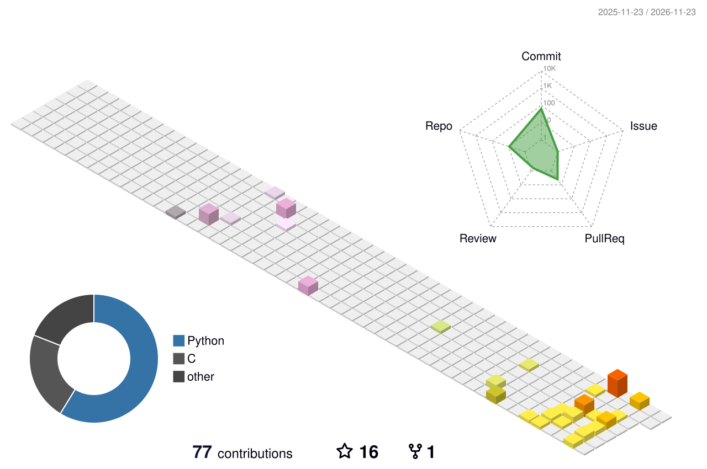

<p align="center">
  
</p>

<p align="center">
  <a href="https://github.com/heartpain-kong">
    
  </a>
</p>

<p align="center">
  把控制理论写进固件，让机器真正跑起来。
  <br/>
  <sub>Open-source firmware for legged robots — DM02 motor drivers · Tianshu / Liguang team control stacks · LgDog1 RL training · RoboCon 2027 field models</sub>
</p>

<p align="center">
  
  
  
</p>

## 🍮 关于我

```yaml
👋 name      : 空情心白  (heartpain-kong)
🤖 role      : 机器人运动控制 / 嵌入式开发者
🎯 focus     : [ 四足运控, 电机驱动, 底盘控制 ]
🛠️ working   : DM02 开发板开源 · LGRobotSystem
🧠 learning  : 强化学习运控 · Sim2Real
💬 ask me    : STM32H7 / mjlab
📫 reach     : github.com/heartpain-kong
```

<table align="center" width="100%">
<tr>
<td valign="top" width="42%">

### 🧭 现在在做

- 🦿 **[LgDog1 强化学习运控](https://github.com/heartpain-kong/mjlab_MGDP)**<br/>&nbsp;&nbsp;mjlab + MuJoCo-Warp 并行训练，盲走 HIM 策略
- 🧩 **[战队控制固件](https://github.com/heartpain-kong/TSRobotSystem)**<br/>&nbsp;&nbsp;天枢（RM）/ 漓光（RC），H723 双 MCU 底盘
- 🏁 **[RoboCon 2027](https://github.com/heartpain-kong/rc2027_field)**<br/>&nbsp;&nbsp;赛题拆解 + 场地 MuJoCo 模型

</td>
<td valign="top" width="58%">

### 🛠️ 技术栈

<p>
  
  
  
  
  
  
  
  
  
  
  
</p>

</td>
</tr>
</table>

<br/>

## 📦 精选作品

| 项目 | 简介 | 技术 |
| :--- | :--- | :--- |
| **[mjlab_MGDP](https://github.com/heartpain-kong/mjlab_MGDP)** | LgDog1 深度感知四足强化学习：基于 mjlab + MuJoCo-Warp 的并行训练框架，含盲走 HIM（仅本体感知）策略、分档地形课程与本地 Web 曲线看板 | `Python` `MuJoCo` |
| **[TSRobotSystem](https://github.com/heartpain-kong/TSRobotSystem)** | 天枢战队 RM 步兵控制系统：STM32H723 舵轮底盘双 MCU（下位机 + 上板），`robot_def.h` 一行切板，配套 PC / Ubuntu / Android 调试助手 | `C` `STM32H723` |
| **[LGRobotSystem](https://github.com/heartpain-kong/LGRobotSystem)** | 漓光战队 RoboCon 控制固件：主控 H723 + 从板 F407 + miniPC，485 一发一回链路与分层架构 | `C` `STM32H723` |
| **[rc2027_field](https://github.com/heartpain-kong/rc2027_field)** <br/>  | ABU RoboCon 2027 场地的 MuJoCo 模型：静态版 + 比赛件可动版（12 天空块 / Mustika / 40 地块），已实测加载与推动 | `Python` `MuJoCo` `XML` |

## 📊 数据

<p align="center">
  <picture>
    <source media="(prefers-color-scheme: dark)" srcset="https://github-readme-stats.vercel.app/api?username=heartpain-kong&show_icons=true&hide_title=true&hide_border=true&bg_color=150B18&title_color=F9A8D4&icon_color=C084FC&text_color=E8D5E2&ring_color=F472B6&card_width=400">
    <source media="(prefers-color-scheme: light)" srcset="https://github-readme-stats.vercel.app/api?username=heartpain-kong&show_icons=true&hide_title=true&hide_border=true&bg_color=FFFFFF&title_color=BE185D&icon_color=7C3AED&text_color=57606A&ring_color=DB2777&card_width=400">
    
  </picture>
</p>

<p align="center">
  <picture>
    <source media="(prefers-color-scheme: dark)" srcset="https://streak-stats.demolab.com/?user=heartpain-kong&hide_border=true&background=150B18&stroke=F472B6&ring=F9A8D4&fire=C084FC&currStreakNum=FFF1F6&sideNums=FFF1F6&currStreakLabel=F9A8D4&sideLabels=E8D5E2&dates=96708A">
    <source media="(prefers-color-scheme: light)" srcset="https://streak-stats.demolab.com/?user=heartpain-kong&hide_border=true&background=FFFFFF&stroke=DB2777&ring=DB2777&fire=7C3AED&currStreakNum=1F2328&sideNums=1F2328&currStreakLabel=BE185D&sideLabels=57606A&dates=8C959F">
    
  </picture>
</p>

<p align="center">
  <picture>
    <source media="(prefers-color-scheme: dark)" srcset="https://github-readme-stats.vercel.app/api/top-langs/?username=heartpain-kong&layout=compact&hide_border=true&bg_color=150B18&title_color=F9A8D4&text_color=E8D5E2&langs_count=6&card_width=400&exclude_repo=LocoWiki,HIMLoco,damiao_mc02_bsp,the_past_of_curc-robocon,LeggedWiki.github.io">
    <source media="(prefers-color-scheme: light)" srcset="https://github-readme-stats.vercel.app/api/top-langs/?username=heartpain-kong&layout=compact&hide_border=true&bg_color=FFFFFF&title_color=BE185D&text_color=57606A&langs_count=6&card_width=400&exclude_repo=LocoWiki,HIMLoco,damiao_mc02_bsp,the_past_of_curc-robocon,LeggedWiki.github.io">
    
  </picture>
</p>

## 🐍 贡献

<p align="center">
  <picture>
    <source media="(prefers-color-scheme: dark)" srcset="https://raw.githubusercontent.com/heartpain-kong/heartpain-kong/output/github-snake-dark.svg">
    <source media="(prefers-color-scheme: light)" srcset="https://raw.githubusercontent.com/heartpain-kong/heartpain-kong/output/github-snake.svg">
    
  </picture>
</p>

<p align="center">
  <picture>
    <source media="(prefers-color-scheme: dark)" srcset="./profile-3d-contrib/profile-night-view.svg">
    <source media="(prefers-color-scheme: light)" srcset="./profile-3d-contrib/profile-season-animate.svg">
    
  </picture>
</p>

## 📚 学习与分享

- **[LocoWiki](https://locowiki.github.io/)** — 四足运控入门路线：从基础理论到论文复现的索引
- **[HIMLoco](https://github.com/heartpain-kong/HIMLoco)** — 上游：Hybrid Internal Model / H∞ 运控官方实现（跟随复现）
- **[damiao_mc02_bsp](https://github.com/heartpain-kong/damiao_mc02_bsp)** — 上游：达妙 DM-MC02-H7 官方底层库（参考）

<div align="center">
  
</div>

<p align="center">
  <sub><b>In brief</b> — I develop legged-robot motion control and embedded firmware, and open-source the parts that others can reuse: motor drivers, team control stacks, an RL training framework, and RoboCon field models. Issues and PRs are welcome.</sub>
</p>
